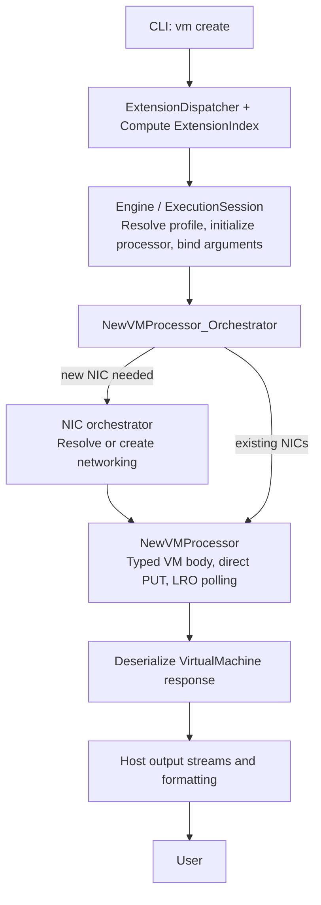

# Existing azclips VM creation design

Source snapshot: [Azure/azclips, commit `03da921`](https://github.com/Azure/azclips/tree/03da921fdc26d449a4ed22e5b7fd6ae896c763a0), inspected on November 12, 2026.

## Does it select a template backend?

No. Upstream `vm create` does **not** follow `CLI -> factory -> selected template backend -> result -> user`. It dispatches to a VM orchestrator that calls individual Azure resource APIs. It does not build an ARM deployment template or select a Bicep backend for this command.

The template-backend factory belongs to this POC's Python implementation, not the existing azclips VM creation path.

## Existing flow

| Stage | Responsibility and source |
| --- | --- |
| Dispatch | The [CLI](https://github.com/Azure/azclips/blob/03da921fdc26d449a4ed22e5b7fd6ae896c763a0/src/CLI/Program.cs#L226-L247) parses a command invocation and opens an engine session. [Compute registration](https://github.com/Azure/azclips/blob/03da921fdc26d449a4ed22e5b7fd6ae896c763a0/src/Extensions/Compute/ExtensionIndex.cs#L505-L511) maps `vm create` to `NewVMProcessor_Orchestrator`. |
| Runtime setup | [ExecutionSession](https://github.com/Azure/azclips/blob/03da921fdc26d449a4ed22e5b7fd6ae896c763a0/src/Core/Core.Engine/ExecutionSession.cs#L251-L276) resolves the profile, creates/initializes the registered processor, and binds arguments. Its [run method](https://github.com/Azure/azclips/blob/03da921fdc26d449a4ed22e5b7fd6ae896c763a0/src/Core/Core.Engine/ExecutionSession.cs#L80-L95) calls `ProcessAsync`. The [engine context](https://github.com/Azure/azclips/blob/03da921fdc26d449a4ed22e5b7fd6ae896c763a0/src/Core/Core.Engine/Engine.cs#L123-L153) supplies profile-based authentication, HTTP pipeline, events, and output handling. |
| VM orchestration | [NewVMProcessor_Orchestrator](https://github.com/Azure/azclips/blob/03da921fdc26d449a4ed22e5b7fd6ae896c763a0/src/Extensions/Compute/Customization/NewVMProcessor_Orchestrator.cs#L91-L216) validates/resolves image, OS, security, and network choices. It reuses supplied NICs or runs the NIC orchestrator, then configures and invokes `NewVMProcessor`. |
| Network orchestration | [NewNetworkInterfaceProcessor_Orchestrator](https://github.com/Azure/azclips/blob/03da921fdc26d449a4ed22e5b7fd6ae896c763a0/src/Extensions/Compute/Customization/NewNetworkInterfaceProcessor_Orchestrator.cs#L50-L142) looks up selected resources and creates required networking. Independent subnet/VNet, NSG, and public-IP work can overlap; NIC creation waits for their IDs. VM creation waits for the NIC. |
| Resource request | [NewVMProcessor](https://github.com/Azure/azclips/blob/03da921fdc26d449a4ed22e5b7fd6ae896c763a0/src/Extensions/Compute/Processors/NewVMProcessor.cs#L47-L80) builds a typed `VirtualMachine` body and sends `PUT .../providers/Microsoft.Compute/virtualMachines/{name}`. Its [SendAsync override](https://github.com/Azure/azclips/blob/03da921fdc26d449a4ed22e5b7fd6ae896c763a0/src/Extensions/Compute/Processors/NewVMProcessor.cs#L196-L201) uses the shared long-running-operation runtime. This is not a `Microsoft.Resources/deployments` request. |
| Result | [ComputeProcessorBase.ProcessAsync](https://github.com/Azure/azclips/blob/03da921fdc26d449a4ed22e5b7fd6ae896c763a0/src/Extensions/Compute/Processors/ComputeProcessorBase.cs#L183-L215) deserializes the response and writes the typed VM object to the output handler. The [CLI configures host output streams](https://github.com/Azure/azclips/blob/03da921fdc26d449a4ed22e5b7fd6ae896c763a0/src/CLI/Program.cs#L149-L167). These are resource results, not this POC's deployment-output dictionary. |

`CreateExtendedProcessor<T>` may look factory-like, but it [constructs a specific child processor and shares the runtime context](https://github.com/Azure/azclips/blob/03da921fdc26d449a4ed22e5b7fd6ae896c763a0/src/Extensions/Compute/Processors/ComputeProcessorBase.cs#L107-L125). It does not choose between JSON and Bicep template backends.

## Where existing Bicep support lives

azclips separately supports ARM template deployment in its Resources extension. [DeploymentRequestBuilder](https://github.com/Azure/azclips/blob/03da921fdc26d449a4ed22e5b7fd6ae896c763a0/src/Extensions/Resources/Customization/DeploymentRequestBuilder.cs#L150-L195) reads JSON templates or compiles a `.bicep` file to JSON. The [resource-group deployment orchestrator](https://github.com/Azure/azclips/blob/03da921fdc26d449a4ed22e5b7fd6ae896c763a0/src/Extensions/Resources/Customization/NewResourceGroupDeploymentProcessor_Orchestrator.cs#L11-L63) validates the template and delegates deployment to a deployment processor. That is a separate command path, not the implementation called by `vm create`.

## Difference from this POC

Existing azclips VM creation owns resource ordering and individual REST calls in C# orchestration code. The proposed Bicep path instead describes resources in Bicep and submits the compiled template as an ARM deployment, leaving template dependency execution to ARM.

The POC's Python JSON builder models Azure CLI-style template assembly. It is not a reproduction of azclips' direct-resource VM orchestration.

The local C# client now selects `direct` or `bicep` below a VM orchestrator. `direct` simulates the existing resource-call pattern for the shared configuration subset; `bicep` demonstrates the proposed deployment path. This changes neither upstream dispatch/session nor upstream VM creation. See the [local implementation and simulation boundary](implementation.md#simulation-boundary).

The [template deployment design](template-deployment-design.md) separately covers proposed JSON/Bicep integration and the simplified template-only end state.

This conclusion comes from source inspection, not an upstream test run or live Azure deployment.
