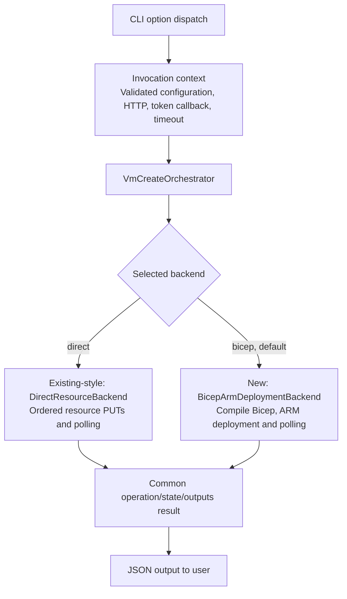

# C# implementation

The C# track compares existing-style resource orchestration with Bicep compilation plus ARM deployment in the [Azure/azclips](https://github.com/Azure/azclips/) language context. It remains a standalone POC rather than an azclips extension or upstream implementation.

Upstream azclips `vm create` dispatches to processors that orchestrate direct resource REST calls. Its [existing design](azclips-existing-design.md) remains unchanged. The local `direct` backend simulates that resource-ownership pattern, not the full upstream engine.

`VmCreateOrchestrator` selects `direct` or `bicep` before either backend builds or executes its request. It never creates a NIC through the direct path before running Bicep. Both paths use the same validated configuration, ARM transport, token provider, cancellation token, and result envelope.

The Python ARM JSON template baseline is different from direct resource creation. C# shares the root [resource architecture](../../docs/architecture.md), not Python's offline lookup modules.

## Code ownership

Paths below are relative to `csharp`.

| File | Responsibility |
| --- | --- |
| `VmCreate\Program.cs` | CLI parsing, invocation-scoped HTTP/authentication/timeout setup, JSON formatting, and exit codes |
| `VmCreate\VmCreateOrchestrator.cs` | Backend selection, operation checks, common result envelope, and `BicepArmDeploymentBackend` |
| `VmCreate\DirectResourceBackend.cs` | Direct resource defaults, ordered request plan, resource execution, and output extraction |
| `VmCreate\Config.cs` | Configuration/public-key validation and typed deployment payload |
| `VmCreate\Processes.cs` | Executable lookup, subprocess execution, Bicep compilation, and Azure CLI token caching |
| `VmCreate\ArmDeployer.cs` | Shared authenticated HTTP, deployment requests, resource PUTs, polling, and operation status checks |
| `VmCreate\VmCreate.csproj` | .NET build settings and shared Bicep build/publish content |
| `VmCreate.Tests\Program.cs` | Offline executable test harness |
| `VmCreate.Tests\VmCreate.Tests.csproj` | Test executable and project reference |

## Execution

The diagram shows deployment. `build` returns each backend's request plan before authentication or HTTP requests; Bicep `validate` returns validation status instead of resource results.

`Cli.RunAsync` reads paired option/value arguments, rejects unknown or duplicate options, and validates operation, backend, and timeout values. `DeploymentConfig.Load` reads configuration and the SSH public key. The CLI creates an HTTP client with redirects disabled and a lazy `AzureCliToken` callback for one invocation. Merely creating these objects does not acquire a token or contact Azure.

The CLI-owned invocation context plays the small local equivalent of session setup. There is no replacement `ExtensionDispatcher`, profile resolver, or `ExecutionSession` framework. Backend selection belongs below that setup, inside the VM orchestrator, not in a second CLI dispatcher.

### New Bicep path

`BicepArmDeploymentBackend` calls `Processes.CompileAsync`, which locates `templates\main.bicep` relative to `AppContext.BaseDirectory`, runs standalone Bicep with `build --stdout`, and parses its ARM JSON output. Compilation does not modify source files.

`DeploymentConfig.Payload` preserves JSON types and wraps each parameter as `{ "value": ... }`. `build` returns this unchanged deployment payload. `validate` POSTs deployment validation; `deploy` PUTs an incremental `Microsoft.Resources/deployments` resource. ARM owns template dependency execution.

The backend unwraps each deployment output's `value`, preserving nested resource objects. Validation has empty outputs.

### Existing-style direct path

`DirectResourceBackend` creates a plan containing `backend: direct` and an ordered `requests` array. Each entry has `resourceType`, `method`, `uri`, and `body`. This is an inspection format, not a deployment template or a separate plan-file execution interface.

The plan creates a VNet with inline subnet unless `existingSubnetId` is supplied, then an NSG, optional public IP, NIC, and VM. The direct backend applies the shared Bicep defaults in C# without invoking the compiler. Marketplace image, SSH, disks, Trusted Launch, diagnostics, and deletion policies match the shared configuration subset.

On `deploy`, each PUT completes before the next resource starts. NIC references use deterministic VNet/subnet, NSG, and public-IP IDs; VM creation follows NIC completion. `ArmDeployer.PutResourceAsync` shares HTTP protection, authentication, failure handling, and polling with template deployments. It follows `Azure-AsyncOperation`, `Operation-Location`, or `Location`, or polls the resource when no header is returned. After an asynchronous operation succeeds, it reads the final resource.

The direct backend extracts IDs and IP addresses from resource responses and returns full VM/NIC objects. The VM orchestrator wraps either backend's outputs in the same `operation`, `state`, and `outputs` result. Errors stop downstream creation; the CLI prints to stderr and returns `1`.

Direct `validate` is rejected before planning or authentication because resource creation has no deployment template to validate.

## Simulation boundary

This POC models where the existing and new execution paths branch. It does not register an azclips command or provide a drop-in extension/dispatcher plugin.

Unlike upstream azclips, direct execution is sequential rather than parallel where possible. It does not perform image discovery, existing-resource lookups, existing-NIC reuse, profile resolution, or typed processor activation. The shared configuration supports only new NIC/NSG resources and an optional existing subnet.

Authentication remains this POC's Azure CLI token subprocess. An upstream integration would retain azclips' dispatcher/session and use its authenticated runtime context, then add backend selection under the VM orchestrator. Upstream's typed VM output would need explicit compatibility handling; the local six-output envelope is not the upstream output contract.

`deploy` sends real Azure requests in either mode, not fake resources. Only the test harness simulates HTTP responses. Partial resources can remain on failure; no rollback, HTTP retries, or cleanup are implemented.

## Processes, authentication, and timeout

`Processes.RunAsync` uses argument lists for native executables and captures stdout/stderr. Windows `.bat` and `.cmd` files use a guarded command-shell launcher, allowing Azure CLI batch launchers while rejecting unsafe arguments. Cancellation kills the subprocess tree.

`AzureCliToken` invokes `az account get-access-token` for the configured subscription and public-Azure management endpoint. It keeps tokens in memory with a short refresh interval.

One cancellation token covers compilation, resource/deployment operations, and polling. `--timeout-seconds` defaults to `1800`; the HTTP client also has a 60-second request timeout. Cancellation does not cancel or roll back an Azure operation.

## Testing

`VmCreate.Tests` runs named asynchronous test functions, reports each pass/failure, and returns a nonzero exit code if any fail. Configuration tests create and clean up temporary public keys and JSON files. ARM tests capture request bodies and use queued fake HTTP responses with an in-memory token callback, without Azure calls.

Backend tests prove that direct build needs neither compiler nor authentication, Bicep stays the default, Bicep does not create resources directly, and direct mode rejects template validation. They exercise configuration mapping, resource prerequisites, synchronous and asynchronous results, both public/private networking, failure/cancellation, and credential protection. Compiler callbacks keep these tests independent of installed Bicep.

The Windows-only batch-launcher test creates a temporary fake Azure CLI launcher. No external test framework is used. See the [C# README](../README.md#tests) for the command and optional real-compiler comparison.
