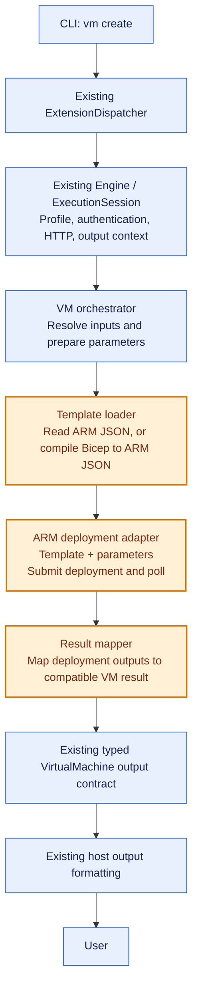
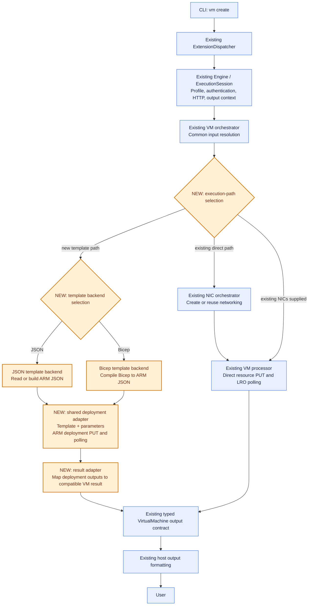

# Template-based VM creation design

This document describes proposed JSON/Bicep integration into azclips VM creation. The [existing upstream design](azclips-existing-design.md) remains documented separately.

Blue shows existing components. Orange shows additions to the VM-create path, which may reuse existing Resources extension helpers.

## Template-only end state

If direct resource creation is retired, remove execution-path selection and the separate template-backend factory. Keep the existing CLI dispatcher, execution session, and VM-specific input resolution.

The loader still needs a small format check when accepting both JSON and Bicep. JSON is already an ARM template; Bicep must be compiled first. This does not require separate backend-selection infrastructure.

The VM orchestrator keeps common validation, input resolution, and parameter mapping, but no longer creates NICs or VMs directly. The template owns resource creation and dependencies; ARM executes them. The deployment adapter uses the existing session's authenticated HTTP context and operation lifecycle.

The result mapper preserves the upstream VM output contract, rather than returning a raw deployment response. The template must return sufficient VM data, or the mapper must read the VM by its output resource ID.

## Comparison while retaining the direct path

During comparison, execution-path selection is necessary because direct resource creation and template deployment have different owners. The template path branches before any direct networking or VM creation.

Both template backends feed the same ARM deployment adapter. Neither runs the existing NIC/resource creation chain first. A shared loader could also replace the separate JSON/Bicep backend-selection layer during comparison.

## Integration boundary and implementation status

No new dispatcher or login session is needed. The separate Resources extension already has JSON/Bicep and deployment support; reuse or extraction of those helpers needs explicit integration, not an automatic backend hook.

Neither diagram describes an implemented upstream change. The local C# POC still implements `direct` and `bicep`, not a JSON-template backend or the template-only end state. Its six-output result envelope also differs from upstream's typed VM output. See the [local implementation](implementation.md#simulation-boundary).
