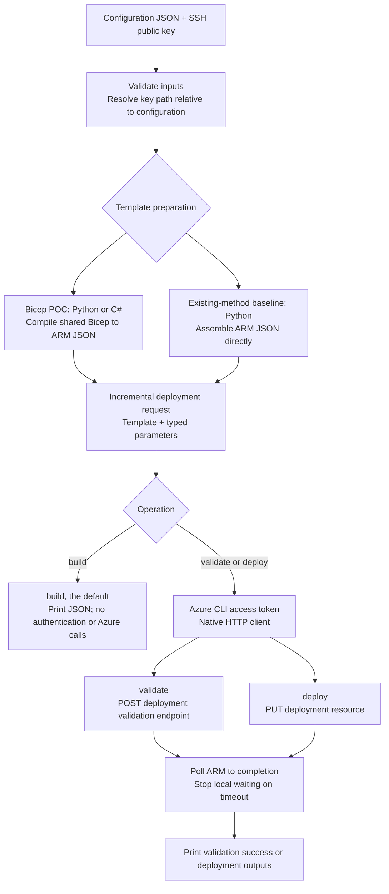
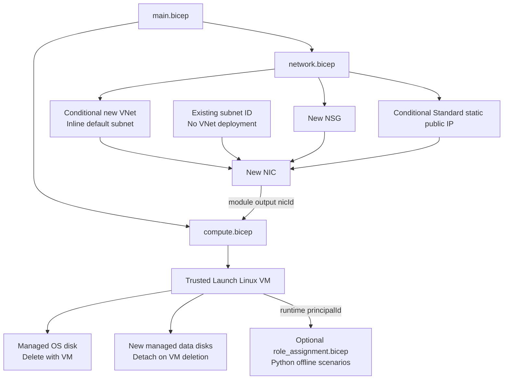

# Shared architecture

This POC evaluates Bicep authoring and ARM template deployment for VM creation. Python represents the existing [Azure CLI](https://github.com/Azure/azure-cli) language context; C# represents the [azclips](https://github.com/Azure/azclips/) context. The local clients are standalone and do not modify either upstream project.

Python and C# use the same configuration contract and default Bicep templates. Their Bicep deployment request bodies should be equivalent. Their internal class structures differ: Python has a template-backend factory and offline resource resolution; C# has a VM orchestrator selecting direct resource creation or Bicep deployment.

See the [Python backend guide](../python/docs/backends.md) and [C# implementation guide](../csharp/docs/implementation.md) for language-specific ownership.

## Comparison boundary

| Path | Template preparation | Deployment |
| --- | --- | --- |
| Azure CLI-style baseline, reproduced in Python | Assemble ARM JSON directly in code | Submit JSON to the ARM deployment API |
| Existing upstream azclips VM creation | Build typed per-resource JSON request bodies | Orchestrate individual resource-provider REST calls |
| Existing-style simulation, C# `direct` | Build an ordered plan of per-resource request bodies | Sequential resource-provider PUTs and polling |
| Bicep POC, Python and C# | Author Bicep and compile it to ARM JSON | Submit compiled JSON to the same ARM deployment API |

All paths use Azure Resource Manager, but individual resource calls are not ARM template deployments. Existing azclips `vm create` has no selectable template backend; see its [source-linked design](../csharp/docs/azclips-existing-design.md). The local C# selection simulates a proposed integration boundary, not a change to upstream dispatch/session.

The POC compares configuration, resource composition, dependencies, and output contracts. Bicep uses nested deployments while the direct JSON baseline emits flat resources, so their full templates are not expected to be identical. The two Bicep clients should produce equivalent requests. Offline checks do not prove live deployment parity or full Azure CLI/azclips feature coverage.

## Template deployment flow

Clients submit ARM JSON, not Bicep source. Each parameter is wrapped as `{ "value": ... }`, preserving booleans, integers, arrays, and objects. Local fields such as `subscriptionId` and `sshPublicKeyPath` are not template parameters.

Both Bicep clients invoke the standalone compiler with `build main.bicep --stdout`. They compile authored sources directly, without token replacement, temporary source copies, or generated JSON beside the source files. Bicep resource API versions are fixed literals: deployment parameters cannot change resource type declarations.

Python can alternatively assemble a flat ARM resource list without Bicep. Its build-only simulation resolves dummy inventory before either backend runs. C# does not accept that simulation configuration.

## Direct resource comparison

C# can instead select existing-style direct creation before any Bicep compilation or resource execution. It uses the same validated configuration, authenticated HTTP transport, timeout, and six-output contract.

`build` prints an ordered request plan, not an ARM deployment payload. `deploy` creates required networking, waits for NIC completion, and then creates the VM through resource-provider APIs. The client owns this ordering instead of ARM's template dependency engine. There is no template to submit for `validate`.

The local simulation is sequential and covers only the shared configuration subset; it does not reproduce upstream discovery, parallel scheduling, dispatcher/session infrastructure, or typed output. Details stay in the [C# implementation guide](../csharp/docs/implementation.md).

## Template ownership and dependencies

The shared source lives in `python\vm_create\templates\bicep`:

| File | Responsibility |
| --- | --- |
| `main.bicep` | Parameters, network/compute module composition, and outputs |
| `network.bicep` | VNet/subnet, NSG, optional public IP, and NIC |
| `compute.bicep` | Linux VM, inline OS/storage/network/security profiles, and optional role-assignment module |
| `role_assignment.bicep` | Separate role-assignment resource for Python's offline identity scenarios |

Python includes these sources as package data. C# copies the same files into its build/publish output and does not require Python at runtime.

Arrows show composition and prerequisites. Bicep derives ARM dependencies from references such as `nsg.id` and `network.outputs.nicId`. An existing subnet is only an ID reference and is not updated.

The compiler emits nested `Microsoft.Resources/deployments` for the network and compute modules. Python's ARM backend instead emits flat resources with explicit dependencies. Python's offline choices can also reuse networking, create only a missing child subnet, or attach existing NICs.

OS disks, image references, and security settings are properties of one `Microsoft.Compute/virtualMachines` resource. They stay together rather than introducing object-only modules. Role assignment has a separate module because it owns a distinct ARM resource.

## Authentication and polling

Both clients use `az account get-access-token` for the configured subscription, with short-lived in-memory token caching. Tokens do not appear in printed requests or configuration files. Native HTTP clients send ARM requests; neither client invokes `az deployment`.

Polling follows ARM's `Azure-AsyncOperation` or `Location` header; C# also accepts `Operation-Location`. Deployment polling falls back to the deployment resource when headers are absent. After asynchronous deployment succeeds, the client fetches the deployment resource for outputs. C# direct operations use the same transport protection and polling, fetching final resource responses after asynchronous completion.

Clients reject polling URLs outside `https://management.azure.com` and disable HTTP redirects to avoid forwarding credentials elsewhere. Failed and canceled operations produce errors. A local timeout does not cancel the Azure operation.

## Results

Both clients print JSON on stdout and errors on stderr, with a nonzero exit code for errors. Template `build` prints `properties.mode`, `properties.template`, and typed `properties.parameters`, ready for the ARM deployment API. C# direct build instead prints a `requests` array containing resource types, PUT URIs, and bodies.

Successful validation reports `operation: validate`, `state: Succeeded`, and empty `outputs`, because no resources were deployed. Successful deployment reports `operation: deploy`, `state: Succeeded`, and these outputs:

| Output | Meaning |
| --- | --- |
| `vmId` | VM resource ID |
| `nicId` | NIC resource ID |
| `privateIpAddress` | Assigned private address |
| `publicIpAddress` | Public address, or an empty string when disabled |
| `virtualMachine` | Full ARM VM resource envelope, including nested `properties` |
| `networkInterface` | Full ARM NIC resource envelope, including nested `properties` |

Bicep forwards resource objects from module outputs; Python's ARM template backend uses equivalent full ARM references. C# direct mode uses final VM/NIC resource responses. Objects, arrays, and nulls are preserved. These objects are not the complete deployment response or VM instance view.

Template `build` includes output definitions, not resolved resource objects. Direct build also has no resolved outputs. In Python's reused-NIC scenarios, summary outputs refer to the first NIC and public-IP discovery is not performed.

## Verification ownership

[Python tests](../python/README.md#tests) cover Python behavior and real-compiler scenarios. The optional Python build check also compares complete Bicep payloads with C#. [C# tests](../csharp/README.md#tests) use a standalone executable harness. All checks are offline and live under their respective language directories.
